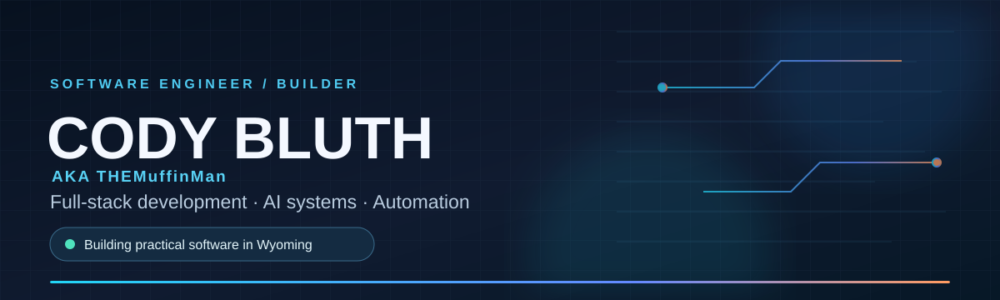

 

**Building useful software at the intersection of AI, automation, and real-world operations.**

[About](#about) · [Featured work](#featured-work) · [Technology](#technology) · [What I'm exploring](#what-im-exploring) · [Connect](#connect)

---

## About

I'm **Cody Bluth**, also known as **TheMuffinMan** — a full-stack software engineer and builder based in Wyoming.

I design and develop web, desktop, and mobile applications, with a particular interest in **local-first AI, intelligent automation, developer tools, and construction technology**. Alongside engineering, I run a construction business, which gives me a direct perspective on the operational problems software can solve.

My focus: **thoughtful architecture, intuitive experiences, and technology that works in the real world.**

---

## Featured work

<table>
<tr>
<td width="50%" valign="top">

### 🏗️ Peak FSM

**Field service & construction operations**

An integrated platform focused on project workflows, estimates, invoicing, scheduling, and mobile workforce coordination, with AI-assisted capabilities.

`Vue` `Quasar` `GraphQL` `PostgreSQL`

</td>
<td width="50%" valign="top">

### 🤖 Local AI Agent Framework

**Local-first intelligence & automation**

Exploring tool-enabled agents, memory, local model inference, workflow orchestration, and human-in-the-loop execution.

`Python` `Ollama` `Docker` `n8n`

</td>
</tr>
<tr>
<td width="50%" valign="top">

### 🟢 Matrix Screensaver Pro

**Creative Windows desktop software**

A graphics-focused screensaver project exploring custom visual effects, rendering performance, and configurable themes.

`C#` `WPF` `.NET` `DirectX`

</td>
<td width="50%" valign="top">

### 📱 Workforce Mobile Apps

**Mobile-first tools for field teams**

Applications designed around practical field workflows, job information, and productivity away from the desk.

`TypeScript` `Vue` `Quasar` `Capacitor`

</td>
</tr>
</table>

> **Project note:** Some work is in active development or maintained privately. Public repositories and demos will be linked here when available.

---

## Technology

**Languages & frameworks**

**Data, infrastructure & tools**

Additional experience with **GraphQL · Express · REST APIs · Firebase · TensorFlow · Ollama · n8n · Nextcloud · Capacitor**.

---

## What I'm exploring

- **AI agents:** local inference, tool use, memory systems, and reliable human approval flows.
- **Construction technology:** turning operational bottlenecks into practical software workflows.
- **Automation:** connecting applications, infrastructure, and business processes.
- **Creative engineering:** interactive software, visual experiments, and high-performance interfaces.

---

## GitHub activity

<!-- Optional: add GitHub stats when using a reliable hosted endpoint or generated static SVG.
     Third-party live stats services can hit rate limits or return broken images. -->

---

## Connect

I'm interested in collaborating on **developer tooling, AI-powered workflows, automation, and practical software products**.

- [GitHub — @cbluth95](https://github.com/cbluth95)
- [LinkedIn — Cody Bluth](https://www.linkedin.com/in/cody-bluth-1361a4174/)

Designed with intention. Built to solve real problems.

